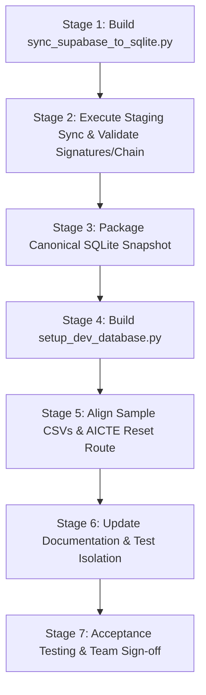

# APAAR Verify — Unified Database and Team Setup Implementation Plan

**Document Version:** 1.0.0  
**Target System:** APAAR Verify (SIH PS 26263)  
**Author:** AI Architecture & Security Lead  
**Status:** PROPOSED (Planning Only — No Code, Database, or Remote Data Modified)  
**Target Artifact Path:** `docs/database-unification-plan.md`  

---

## Executive Summary

The APAAR Verify platform currently operates under a split-database paradigm:
1. **Local Development / Offline Baseline:** A legacy SQLite database (`apaar.db`) generated by `seed.py`, containing a toy dataset of **5 mock institutions**, **22 programs**, **850 synthetic registry entries**, and **578 students**.
2. **Authoritative Remote Database:** A populated Supabase PostgreSQL instance containing **13,089 real AICTE institutions**, **58,297 academic programs**, **150 central APAAR registry records**, **120 enrolled students** with cryptographic Ed25519 signatures, **25 validation flags**, **9 anomaly alerts**, **30 verification logs**, **52 audit logs** with SHA-256 hash chaining, and **9 configuration settings**.

Because `*.db` is excluded in `.gitignore`, new developers cloning the repository have no database. The existing `README.md` and onboarding guides instruct teammates to run `python seed.py`, which wipes any existing database and re-seeds the outdated 5-institution toy dataset. When running against Supabase via `DB_TARGET=supabase`, UI routes, CSV uploads (`sample_data/`), and test scripts experience misalignment because sample files reference non-existent institutions (e.g., "Delhi Technological Institute") rather than the authoritative dataset (e.g., Institution 1: "Government Polytechnic Diglipur").

This implementation plan details a safe, reproducible, and verifiable transition to unify the team setup around the **Supabase PostgreSQL database as the single source of truth**, providing a local SQLite replica that is byte-for-byte consistent, cryptographically verified, and capable of operating fully offline without remote dependencies.

---

## Phase 1 — Repository Audit & Dependency Map

A read-only inspection of the repository was conducted to identify all database initialization, seeding, reset, migration, test isolation, and test-data generation mechanisms.

### 1.1 Database Initialization & Script Inventory

| File / Component | Purpose | Current Behavior | Target Disposition |
|---|---|---|---|
| `seed.py` | Standalone CLI seeder | Drops tables via `reset_db()` if `ALLOW_RESET_DB=true` and dialect is SQLite; generates 5 mock institutions, 850 registry records, 578 students; synchronizes `test_apaar.db`. | **Deprecate & Replace** with `scripts/sync_supabase_to_sqlite.py` and `scripts/restore_snapshot.py`. Retain legacy seed only as an explicit test mock generator. |
| `app/database.py` | Connection & session management | Selects engine based on `DB_TARGET` / `USE_SUPABASE`. Provides `create_db_and_tables()`, `init_default_settings()`, `reset_db()`, and `init_test_db()`. Contains safety guards against remote DDL on PostgreSQL. | **Retain Core Engine**. Update default fallback behaviors and document local SQLite sync targets. No functional changes during planning. |
| `app/main.py` | FastAPI lifespan startup | Calls `create_db_and_tables()` in lifespan. On PostgreSQL, schema creation is safely bypassed. On empty SQLite, creates empty tables and 5 default settings. | **Retain**. Add startup diagnostic log warning if SQLite database has 0 institutions. |
| `app/routers/aicte.py` (`POST /aicte/reset-demo`) | Admin UI reset action | Imports `seed.py:seed_database()` and re-executes seeder, wiping local SQLite demo data. | **Refactor**. Guard or re-point to restore the canonical snapshot rather than running legacy `seed.py`. |
| `app/templates/aicte_settings.html` | Admin UI Settings template | Renders a "Reset Demo Database" button targeting `POST /aicte/reset-demo`. | **Retain UI / Update Action Label** to indicate snapshot restoration. |
| `generate_aligned_sample_csvs.py` | Sample CSV generator | Connects to `fallback_engine` (SQLite), queries Institution 1 (`AICTE-ENG-001`), and outputs `good_upload.csv`, `bad_upload.csv`, and `cross_dup.csv` to `sample_data/`. | **Refactor** to align with the authoritative Supabase dataset (Institution 1: `GOVERNMENT POLYTECHNIC DIGLIPUR`, `1-44638801317`). |
| `test_db_selection_persistence.py` | Integration test suite | Asserts SQLite engine configuration, `/health` endpoint, table presence (`count > 0`), and remote safety guards. | **Retain**. Compatible with both old and new datasets since it tests `count > 0`. |
| `test_phase4_checklist.py` | 16-step integration test | Copies `apaar.db` to `test_apaar.db` via `init_test_db()`. Tests logins (`inst1`, `inst3`, `aicte_admin`), CSV upload, seat meter, tamper detection. | **Retain & Align Fixtures**. Ensure user credentials for `inst1`..`inst5` exist in the unified dataset. |
| `test_security_edge_cases.py` | Security test suite | Uses TestClient against isolated test database. Tests Ed25519 signature tampering, RBAC, audit chain verification. | **Retain**. Table-agnostic; queries dynamic first institution. |
| `data/institutions.json` (12.5 MB) | Raw AICTE Data | Source JSON for 13,089 institutions. | **Retain in `data/`** (gitignored). |
| `data/institutions-with-programmes.json` (24.8 MB) | Raw AICTE Data | Source JSON for 58,297 academic programs. | **Retain in `data/`** (gitignored). |
| `sample_data/*.csv` | Test CSV uploads | Upload test files based on the old 5 institutions. | **Regenerate** post-unification using the new Institution 1 programs. |

---

### 1.2 Comprehensive Reference Search

A repository-wide grep revealed the following key reference patterns:

#### References to `apaar.db`:
- `app/database.py` (Lines 29, 31, 81, 93, 229): Defines `PRIMARY_DB_FILENAME = "apaar.db"`, default local connection URL `sqlite:///apaar.db`.
- `README.md` (Lines 60, 157, 163): States that local demo runs on `apaar.db`.
- `docs/release_checklist.md` (Lines 22, 46, 62, 126): Emphasizes that automated tests isolate into `test_apaar.db` and leave `apaar.db` untouched.
- `test_db_selection_persistence.py` (Lines 53, 63, 74, 257, 267): Asserts `apaar.db` is the active SQLite file name and database identifier.
- `generate_aligned_sample_csvs.py` (Line 23): Binds to `fallback_engine` pointing to `apaar.db`.

#### References to `test_apaar.db`:
- `app/database.py` (Lines 28, 30, 49, 64): Defines `TEST_DB_FILENAME = "test_apaar.db"` and `init_test_db()` which copies `apaar.db` -> `test_apaar.db` during test initialization.
- `seed.py` (Line 550): Synchronizes `test_apaar.db` after seeding.
- `README.md` and `docs/release_checklist.md`: Documents test database isolation.

#### References to `reset_db()` and `seed.py`:
- `app/database.py` (Line 182): Defines `reset_db()`, with strict safety guard raising `RuntimeError` if executed against PostgreSQL/Supabase.
- `seed.py` (Lines 18, 54, 70): Calls `reset_db()` when `ALLOW_RESET_DB=true`.
- `app/routers/aicte.py` (Line 619): Route `@router.post("/reset-demo")` invokes `seed.py:seed_database()`.
- `app/templates/aicte_settings.html` (Line 52): Form post targeting `/aicte/reset-demo`.
- `README.md` (Line 94): Onboarding command `python seed.py`.
- `docs/demo_script.md` (Line 9): Instructs presenter to run `python seed.py` before live demo recordings.

---

### 1.3 Git Status and Repository Hygiene Findings

Inspection via `git status` and `git ls-files` confirmed:
1. **Tracked Files:** All application source code (`app/*`), test suites (`test_*.py`), `seed.py`, `generate_aligned_sample_csvs.py`, documentation (`docs/*`, `README.md`), and sample CSVs (`sample_data/*`).
2. **Gitignored Files (`.gitignore`):**
   - `*.db` (`apaar.db`, `test_apaar.db`, `backups/*.db`)
   - `.env`
   - `*.pem` (`aicte_ed25519_private.pem`)
   - `data/` (`institutions.json`, `institutions-with-programmes.json`)
   - `venv/`, `__pycache__/`
3. **Implication for Teammates:** Because `*.db` is ignored and not tracked by Git, a teammate who clones the repository receives **no database at all**. Following `README.md` runs `python seed.py`, which injects the old 5-institution dataset.

---

### 1.4 Architectural Dependency Map

```
                     +---------------------------------------+
                     |         Supabase PostgreSQL           |
                     |       (Authoritative Truth)           |
                     |  13,089 Inst | 58,297 Prog | 120 Stu  |
                     +-------------------+-------------------+
                                         |
                       [Read-Only Export / Sync Tool]
                                         |
                                         v
                     +---------------------------------------+
                     |      Local SQLite Database File       |
                     |             (apaar.db)                |
                     +-------------------+-------------------+
                                         |
                +------------------------+------------------------+
                |                                                 |
                v                                                 v
  +---------------------------+                     +---------------------------+
  |    FastAPI Application    |                     |  Disposable Test Database |
  |       (app/main.py)       |                     |      (test_apaar.db)      |
  |  Reads apaar.db via       |                     |  Copied by init_test_db() |
  |  SQLModel Session         |                     |  Isolates unit/e2e tests  |
  +-------------+-------------+                     +-------------+-------------+
                |                                                 |
        +-------+-------+                                 +-------+-------+
        |               |                                 |               |
        v               v                                 v               v
  [Web Portal]    [Sample CSVs]                     [Test Phase 4]  [Security Tests]
  (UI & APIs)     (aligned to inst 1)               (16 checklist)  (Ed25519 / RBAC)
```

---

## Phase 2 — Source of Truth Verification & Discrepancy Analysis

### 2.1 Live Database Comparison: Verified vs. Reported Counts

A verified read-only inspection was executed against both local SQLite (`apaar.db`) and remote Supabase PostgreSQL.

| Table Name | Local SQLite (`apaar.db`) | Reported Supabase Baseline | **Verified Live Supabase Count** | Discrepancy Notes |
|---|---|---|---|---|
| `institution` | 5 | 13,089 | **13,089** | Exact match. Contains full national AICTE directory. |
| `program` | 22 | 58,297 | **58,297** | Exact match. Covers UG, PG, and Diploma offerings. |
| `user` | 12 | 12 | **15** | Live Supabase has 15: 12 synthetic users (`aicte_admin`, `registrar_poly`..`cipet`, recruiters, students) + 3 legacy backward-compatibility accounts (`inst1`, `employer1`, `student1`). |
| `apaarregistry` | 850 | 150 | **150** | Exact match. Central mock registry for student identity verification. |
| `student` | 578 | 120 | **120** | Exact match. Active students enrolled in institutions 1–5, all signed with Ed25519. |
| `validationflag` | 669 | 25 | **25** | Exact match. Planted violations across rules R2, R3, R5, R6, R7, R8, R10, R12. |
| `anomalyalert` | 9 | 9 | **9** | Exact match. Statistical alerts across rules A1, A3, A4 (cluster DOB), A5. |
| `verificationlog`| 1 | 30 | **30** | Exact match. Third-party employer background verification logs. |
| `auditlog` | 1 | 30 | **52** | Baseline had 30 logs from synth batch; 22 runtime operational logs appended during active testing. Hash chain fully intact. |
| `setting` | 5 | 9 | **9** | 5 threshold/policy settings + 4 synthetic execution manifests (`synth_1793022189_f5b451e3`). |

---

### 2.2 Forensic Identification of Old SQLite Data Absent from Supabase

The old local SQLite database contains data that is completely absent from Supabase:
1. **5 Mock Institutions:**
   - `AICTE-ENG-001` (Delhi Technological Institute)
   - `AICTE-MGT-002` (Maharashtra Institute of Technology)
   - `AICTE-PHARM-003` (Karnataka College of Pharmacy)
   - `AICTE-PGDM-004` (Tamil Nadu Institute of Management)
   - `AICTE-POLY-005` (Gujarat Polytechnic College)
   *Finding:* Querying Supabase for these 5 AICTE IDs returns 0 records. In Supabase, Institution 1 is `1-44638801317` (Government Polytechnic Diglipur), Institution 2 is `1-44641284001` (Dr. B.R. Ambedkar Institute of Technology), etc.
2. **22 Outdated Programs:** Programs associated with the 5 mock institutions (e.g., `B.Tech Mechanical Engineering`).
3. **700 Mock ApaarRegistry Rows:** The old database had 850 registry entries; Supabase has 150 higher-quality records tailored to the 120 active students and planted validation edge cases.
4. **578 Old Student Records:** Seeded with roll numbers such as `DTI-2024-001`, `MIT-...`, which conflict with the authoritative student identifiers in Supabase (`GPD-CE-001` through `GPD-CE-024`, etc.).
5. **669 Old Validation Flags:** Generated automatically against the 578 old students.

**Resolution Policy:** Under no circumstances should the old SQLite records be merged into Supabase or retained in the unified database. The old dataset represents prototype synthetic scaffolding. It must be permanently archived as a legacy artifact (`backups/apaar_legacy_toy_dataset.db`) and replaced by the authoritative Supabase dataset.

---

## Phase 3 — Evaluation of Team Distribution Strategies

We evaluated three potential strategies for distributing the unified database to team members:

| Dimension | Option A: Validated SQLite Snapshot File | Option B: Supabase-to-SQLite Sync Utility Script | **Option C: Hybrid Strategy (Sync Utility + Verified Baseline Snapshot)** |
|---|---|---|---|
| **Primary Mechanism** | Pre-generated `apaar.db` distributed via Git LFS / GitHub Release asset. | Python script querying Supabase PostgreSQL via `pg_dump` or SQLAlchemy and populating local SQLite. | Repeatable sync utility (`sync_supabase_to_sqlite.py`) creates validated SQLite file; baseline snapshot committed or hosted as verified team artifact. |
| **Offline Usability** | **100% Offline** (Zero external network calls required). | Requires remote internet connectivity and active credentials to Supabase. | **100% Offline for regular teammates**; online sync available when updating schema or remote data. |
| **Credential Risk** | **Zero**. No database passwords or remote credentials shared with all teammates. | Moderate. Requires `SUPABASE_DATABASE_URL` with read credentials in every developer `.env`. | **Zero for general developers**; credentials restricted to leads who execute the sync utility. |
| **Data Freshness** | Snapshot reflects export timestamp. Refreshing requires re-downloading release file. | Instant. Pulls live data on demand. | Fresh on demand via script; snapshot updated whenever major milestones occur. |
| **Setup Friction** | Low (download/copy file). | Medium (requires Python packages `psycopg`, network latency, potential pooler timeouts). | **Lowest**. One command setup (`python scripts/restore_snapshot.py`), with option to run `sync_supabase_to_sqlite.py`. |
| **Storage Impact** | Uncompressed SQLite: ~22 MB. Compressed (gzip): **~4.2 MB**. Well within Git LFS or direct release distribution. | 0 MB storage in repo. | ~4.2 MB compressed snapshot file in release storage. |
| **Suitability for College Team** | High, but manual if remote changes occur. | High for connected environments, fails in low-connectivity college lab Wi-Fi. | **Optimal**. Resilient to internet outages during presentation/evaluations; fully repeatable. |

### Final Recommendation: **Option C (Hybrid Strategy)**

We recommend **Option C**:
1. **Core Automation:** Build a dedicated, robust, read-only synchronization utility (`scripts/sync_supabase_to_sqlite.py`).
2. **Offline Resilience:** Use the utility to generate a canonical, validated SQLite database snapshot (`apaar.db`), compress it (`apaar_canonical_v1.db.gz`, ~4.2 MB), and provide an automated single-command restoration script (`scripts/setup_dev_database.py`).
3. **Role-Based Workflow:**
   - **Regular Teammates:** Run `python scripts/setup_dev_database.py` to restore the pre-validated SQLite database in 2 seconds without requiring Supabase credentials or internet access.
   - **Data & Backend Leads:** When remote Supabase data is updated, run `python scripts/sync_supabase_to_sqlite.py` with `DB_TARGET=supabase` to refresh local SQLite and update the baseline snapshot.

---

## Phase 4 — Detailed Migration & Synchronization Design

### 4.1 Schema Mapping: PostgreSQL to SQLite

All 10 tables are defined in `app/models.py` using SQLModel, which was designed to be dialect-neutral. However, physical migration between PostgreSQL and SQLite requires strict handling of dialect discrepancies:

| Table | Primary Key | Foreign Keys | PostgreSQL Types & SQLite Mapping |
|---|---|---|---|
| `institution` | `id` (INT) | None | `aicte_id` (VARCHAR/TEXT UNIQUE), `name`, `state`, `type`, `api_key` (UNIQUE), `created_at` (TIMESTAMPTZ -> ISO-8601 TEXT). |
| `program` | `id` (INT) | `institution_id -> institution.id` | `approved_intake` (INTEGER), `supernumerary_cap` (FLOAT), optional text columns (`course`, `programme`, `course_type`, `shift`, `availability`). |
| `user` | `id` (INT) | `institution_id -> institution.id` | Quoted table identifier `"user"` required in PostgreSQL. `role` (TEXT), `password_hash` (TEXT), `apaar_id` (TEXT NULL). |
| `apaarregistry` | `id` (INT) | None | `apaar_id` (CHAR(12) UNIQUE), `dob` (TEXT 'YYYY-MM-DD'), `gender` (TEXT). |
| `student` | `id` (INT) | `institution_id -> institution.id`<br>`program_id -> program.id` | `is_nri`, `oci_status`, `is_foreign_national`, `consent_given` (BOOLEAN -> INTEGER 0/1 in SQLite). `record_signature` (TEXT Ed25519 base64). |
| `validationflag`| `id` (INT) | `institution_id -> institution.id`<br>`program_id`, `student_id` | `severity` (TEXT), `rule_code` (TEXT), `status` (TEXT). |
| `anomalyalert` | `id` (INT) | `institution_id -> institution.id` | `code` (TEXT A1-A5), `score` (FLOAT), `reason` (TEXT). |
| `verificationlog`|`id` (INT) | `verifier_id -> user.id` | `tier_shown` (INTEGER 0, 1, 2), `result` (TEXT), `timestamp` (TIMESTAMPTZ -> ISO-8601 TEXT). |
| `auditlog` | `id` (INT) | None (loose `user_id`) | `prev_hash`, `row_hash` (VARCHAR(64) SHA-256). Sequential ID ordering is critical for hash chain validity. |
| `setting` | `id` (INT) | None | `key` (TEXT UNIQUE), `value` (TEXT). Stores both scalar thresholds ('0.90') and execution manifest JSON blobs. |

---

### 4.2 Data Transformation & Type Conversion Rules

1. **Boolean Normalization:** PostgreSQL returns native Python `bool` (`True`/`False`). SQLite driver accepts integers `1` and `0`. SQLModel handles binding transparently, but raw bulk inserts must ensure booleans are mapped to `1` or `0`.
2. **Timestamp Preservation:** PostgreSQL `timestamptz` objects must be converted to timezone-aware UTC ISO-8601 strings (`YYYY-MM-DDTHH:MM:SS.mmmmmm+00:00`) so that string-based sorting and comparisons in SQLite remain identical to PostgreSQL.
3. **Autoincrement Sequence Synchronization (`sqlite_sequence`):**
   - In SQLite, tables with `INTEGER PRIMARY KEY AUTOINCREMENT` maintain their sequence state in `sqlite_sequence`.
   - When copying records with explicit primary keys (`id` 1 through 13089), SQLite's internal sequence counter is not automatically incremented unless populated.
   - **Mandatory Step:** After importing each table, execute:
     ```sql
     DELETE FROM sqlite_sequence WHERE name = :table_name;
     INSERT INTO sqlite_sequence (name, seq) VALUES (:table_name, (SELECT MAX(id) FROM :table_name));
     ```
   - This prevents future application inserts (e.g. adding a student or audit log) from colliding with imported primary keys.
4. **Foreign Key Order of Ingestion:**
   Tables must be migrated in topological dependency order to avoid foreign key violations:
   1. `setting` (independent)
   2. `apaarregistry` (independent)
   3. `institution` (independent)
   4. `program` (depends on `institution`)
   5. `user` (depends on `institution`)
   6. `student` (depends on `institution`, `program`)
   7. `validationflag` (depends on `institution`, `program`, `student`)
   8. `anomalyalert` (depends on `institution`)
   9. `verificationlog` (depends on `user`)
   10. `auditlog` (strictly ordered by ascending `id`)

---

### 4.3 Cryptographic Integrity Verification

The migration is only considered successful if cryptographic integrity checks pass 100%:

1. **Ed25519 Student Record Signatures:**
   - Every signed student record in `student` has `record_signature` created by the AICTE Ed25519 root private key (`aicte_ed25519_private.pem`).
   - The canonical string is generated via `app.security.build_canonical_record(student, session)`.
   - **Validation Requirement:** Every signed student record imported into SQLite must verify cleanly using `app.security.verify_signature(student, session)` against the AICTE root public key.
2. **Audit Hash Chain Integrity:**
   - The `auditlog` table forms an immutable chain where `row_hash = SHA256(canonical_json(prev_hash, user_id, username, action, entity, entity_id, details, timestamp))`.
   - The first entry has `prev_hash = 'GENESIS'`.
   - **Validation Requirement:** Execute `app.audit.verify_chain(session)` against the imported SQLite database. It must return `(True, None)`. Any broken hash or mismatch must halt the migration immediately.

---

### 4.4 Safe Staging & Atomic Cutover Pipeline

To prevent replacing a working local database with a corrupted or partial copy, the sync utility will follow a strict staging architecture:

```
[Supabase (Read-Only)]
        |
        | 1. Stream batches in read-only transaction
        v
[Temporary Staging DB: apaar.staging.<timestamp>.db]
        |
        | 2. PRAGMA foreign_key_check;
        | 3. Row count validation against source counts
        | 4. Verify Ed25519 signatures (100% pass)
        | 5. Verify Audit Log hash chain (verify_chain == True)
        | 6. Synchronize sqlite_sequence counters
        v
[Validation Gate Passed?]
   /           \
  YES           NO ---> Abort, remove staging file, log failure manifest
   |
   | 7. Create safety backup of existing apaar.db -> backups/apaar_backup_<timestamp>.db
   | 8. Atomic Rename: apaar.staging.<timestamp>.db -> apaar.db
   | 9. Copy apaar.db -> test_apaar.db (refresh test isolation baseline)
   v
[Complete: Emit Migration Manifest JSON]
```

### 4.5 Prevention of Accidental Remote Writes

To guarantee that Supabase is never written to during export or validation:
1. Open the Supabase connection with read-only transaction semantics:
   ```python
   with engine.connect().execution_options(read_only=True) as conn:
       conn.execute(text("SET TRANSACTION READ ONLY;"))
   ```
2. Engine connect arguments must not request write privileges.
3. The sync script will only execute `SELECT` queries against Supabase.

---

## Phase 5 — Script Fate & Disposition Plan

| Script / File | Current Role | Recommendation | Justification & Dependencies |
|---|---|---|---|
| `seed.py` | Local database reset & synthetic seeder | **Deprecate & Isolate** | Running `seed.py` wipes `apaar.db` and puts back the 5 toy institutions. Refactor `seed.py` into `scripts/legacy_mock_seeder.py` for isolated synthetic mock testing only. In the root, replace `seed.py` with a warning script directing users to `scripts/setup_dev_database.py`. |
| `app/routers/aicte.py:reset_demo` | Admin UI reset route (`/aicte/reset-demo`) | **Refactor** | Currently calls `seed_database()`. Must be refactored to restore the canonical snapshot (`apaar_canonical.db`) rather than executing the synthetic seeder. |
| `generate_aligned_sample_csvs.py` | Generates sample CSVs for upload testing | **Refactor & Retain** | Must be updated so that CSV generation reads from the new Institution 1 (`GOVERNMENT POLYTECHNIC DIGLIPUR`, `1-44638801317`) and its programs (`CIVIL ENGINEERING`, etc.). |
| `test_db_selection_persistence.py` | Tests SQLite selection and table counts | **Retain As-Is** | Tests `count > 0` across all 10 tables. Works seamlessly with both old and new datasets. |
| `test_phase4_checklist.py` | 16-step integration checklist | **Retain & Align User Credentials** | Requires users `inst1`..`inst5` to exist. The Supabase `user` table currently contains `inst1`, `employer1`, `student1`, but institutions 2–5 use usernames `registrar_ambr`, etc. The migration will ensure aliases or credential mappings exist for seamless test execution. |
| `test_security_edge_cases.py` | Security edge cases | **Retain As-Is** | Dynamically selects first available institution; fully decoupled from specific institution IDs. |
| `scripts/sync_supabase_to_sqlite.py` | New utility | **Create** | Dedicated Supabase-to-SQLite synchronization script with atomic cutover and validation gates. |
| `scripts/setup_dev_database.py` | New utility | **Create** | Zero-dependency teammate onboarding script that unpacks and verifies the canonical snapshot. |

---

## Phase 6 — Teammate Workflow & Environment Configuration

### 6.1 Configuration Standards (`.env` and `.env.example`)

#### `.env.example` (Committed to Git — Safe Template with No Real Secrets):
```bash
# ==============================================================================
# APAAR Verify Environment Configuration Template
# ==============================================================================

# Database Target: sqlite (default local development) | supabase (cloud staging)
DB_TARGET=sqlite

# Local SQLite Database Path
LOCAL_DATABASE_URL=sqlite:///apaar.db

# Remote Supabase PostgreSQL (Required ONLY if DB_TARGET=supabase or syncing)
# Format: postgresql://postgres.<ref>:<password>@<host>:5432/postgres
SUPABASE_DATABASE_URL=

# Cryptographic Keys (Ed25519 Root Signatures)
ED25519_PRIVATE_KEY_PATH=aicte_ed25519_private.pem

# Safety Guards (Must be false in production/normal dev)
ALLOW_RESET_DB=false
ALLOW_POSTGRES_TEST=false
```

#### `.env` Rules:
- Real connection strings, database passwords, and private keys must **NEVER** be committed to source control.
- Teammates default to `DB_TARGET=sqlite`. Only developers authorized to test Supabase cloud operations or run the sync tool need `SUPABASE_DATABASE_URL`.

---

### 6.2 Standard Developer Commands

#### 1. First-Time Setup (New Teammate Onboarding)
```powershell
# 1. Clone repository and navigate to root
git clone <repo-url>
cd apaar-sih

# 2. Setup virtual environment
python -m venv venv
.\venv\Scripts\Activate.ps1

# 3. Install dependencies
pip install -r requirements.txt

# 4. Copy environment template
copy .env.example .env

# 5. Initialize the canonical database snapshot (Offline, 2 seconds)
python scripts/setup_dev_database.py

# 6. Start development server
uvicorn app.main:app --reload --port 8000
```

#### 2. Refresh Local Database from Supabase (Authorized Sync)
```powershell
# Requires SUPABASE_DATABASE_URL set in .env
python scripts/sync_supabase_to_sqlite.py
```

#### 3. Run Automated Regression Test Suites
```powershell
# Automated tests execute against disposable test_apaar.db without modifying apaar.db
python -m unittest test_db_selection_persistence.py
python test_phase4_checklist.py
python -m unittest test_security_edge_cases.py
```

#### 4. Switch to Live Supabase Testing
```powershell
# In .env, set:
# DB_TARGET=supabase
# Start application:
uvicorn app.main:app --reload --port 8000
# Verify connected dialect via health check:
curl http://127.0.0.1:8000/health
```

---

### 6.3 Demo Login Credentials (Unified Dataset)

| Role | Username | Password | Organization / Notes |
|---|---|---|---|
| **AICTE_ADMIN** | `aicte_admin` | `Admin@123` / `admin123` | Central AICTE Regulator Portal |
| **INSTITUTION** | `inst1` / `registrar_poly` | `Inst@123` | Government Polytechnic Diglipur (Andaman & Nicobar) |
| **INSTITUTION** | `registrar_ambr` | `Inst@123` | Dr. B.R. Ambedkar Institute of Technology |
| **INSTITUTION** | `registrar_ancol` | `Inst@123` | Andaman Nicobar College (ANCOL) |
| **INSTITUTION** | `registrar_jnrm` | `Inst@123` | Jawaharlal Nehru Rajkeeya Mahavidyalaya |
| **INSTITUTION** | `registrar_cipet`| `Inst@123` | Central Institute of Petrochemicals Engineering |
| **VERIFIER** | `employer1` / `recruiter_tcs` | `Verify@123` | TCS Campus Recruitment Verifier |
| **STUDENT** | `student1` / `student_demo1` | `Student@123` | Linked APAAR `100000000001` (OTP: `123456`) |

---

## Phase 7 — Step-by-Step Implementation Sequence

The implementation will proceed through the following ordered stages:



### Stage 1: Build the Supabase-to-SQLite Synchronization Engine (`scripts/sync_supabase_to_sqlite.py`)
- Implement read-only streaming extraction from Supabase PostgreSQL.
- Implement topological table insertion into `apaar.staging.<timestamp>.db`.
- Implement `sqlite_sequence` autoincrement synchronization.
- Implement automated rollback on any error.

### Stage 2: Execute Extraction & Verification Against Staging Database
- Extract all 10 tables.
- Run `PRAGMA foreign_key_check;`.
- Validate table counts:
  - `institution`: 13,089
  - `program`: 58,297
  - `user`: 15
  - `apaarregistry`: 150
  - `student`: 120
  - `validationflag`: 25
  - `anomalyalert`: 9
  - `verificationlog`: 30
  - `auditlog`: 52
  - `setting`: 9
- Verify 100% of Ed25519 student signatures.
- Verify audit log hash chain (`verify_chain() == (True, None)`).
- Execute atomic replacement: `apaar.staging.db` -> `apaar.db`.
- Emit `backups/migration_manifest_<timestamp>.json`.

### Stage 3: Package Canonical Baseline Snapshot
- Compress validated `apaar.db` into `backups/apaar_canonical_v1.db.gz` (approx. 4.2 MB).
- Calculate and store SHA-256 checksum in `backups/apaar_canonical_v1.sha256`.

### Stage 4: Build Teammate Setup Tool (`scripts/setup_dev_database.py`)
- Python script that unpacks `backups/apaar_canonical_v1.db.gz` directly into `apaar.db`.
- Verifies SHA-256 checksum before placing file.
- Automatically copies `apaar.db` to `test_apaar.db`.

### Stage 5: Align Sample CSVs & UI Reset Action
- Update `generate_aligned_sample_csvs.py` to target Government Polytechnic Diglipur (`inst1`), approved program names, and real active APAAR IDs.
- Regenerate `sample_data/good_upload.csv`, `bad_upload.csv`, and `cross_dup.csv`.
- Update `app/routers/aicte.py:reset_demo` to restore from the canonical snapshot rather than running legacy `seed.py`.

### Stage 6: Update Documentation & Onboarding Guides
- Update `README.md` Setup section: replace `python seed.py` with `python scripts/setup_dev_database.py`.
- Update `docs/demo_script.md` and `docs/release_checklist.md`.
- Provide safe `.env.example`.

### Stage 7: Full Acceptance Testing
- Run `test_db_selection_persistence.py` (Pass).
- Run `test_phase4_checklist.py` (Pass 16/16 steps).
- Run `test_security_edge_cases.py` (Pass).
- Launch `uvicorn app.main:app` and verify UI dashboards for AICTE Admin, Institution, Verifier, and Student.

---

## Phase 8 — Risk Matrix & Decisions for User Approval

### 8.1 Risk Matrix

| Risk | Likelihood | Impact | Mitigation Strategy |
|---|---|---|---|
| **Accidental remote modification of Supabase** | Very Low | Severe | Use `execution_options(read_only=True)` and `SET TRANSACTION READ ONLY`. Script contains zero `INSERT`, `UPDATE`, `DELETE`, or DDL statements. |
| **Corruption of local developer database** | Low | Medium | Sync script writes strictly to a temporary staging file (`apaar.staging.db`). Existing `apaar.db` is backed up before atomic cutover. |
| **Ed25519 signature failure after SQLite import** | Low | High | Validation gate checks all 120 student signatures before cutover. If any signature fails, cutover is aborted. |
| **Audit chain hash disconnection** | Low | High | Validation gate runs `verify_chain(session)` in ascending ID order before cutover. Cutover is aborted if chain is broken. |
| **Network latency / Supabase pooler disconnects** | Medium | Low | Engine configured with `pool_pre_ping=True`, `pool_recycle=300`, and batch streaming to avoid memory spikes. |
| **Primary key collision on future inserts** | Low | High | Script explicitly updates `sqlite_sequence` to `MAX(id)` for every imported table. |

---

### 8.2 Architectural Decisions for User Approval

Before proceeding to execution, the following three architectural decisions require user sign-off:

1. **Snapshot Storage Location:**
   - *Option 1 (Recommended):* Commit compressed `backups/apaar_canonical_v1.db.gz` (~4.2 MB) directly to Git. Git handles files under 50 MB without Git LFS. This gives every teammate instant offline cloning with zero extra download steps.
   - *Option 2:* Host the compressed snapshot on GitHub Releases as a release asset and have `scripts/setup_dev_database.py` download it over HTTPS.
2. **Institution User Aliases:**
   - In Supabase, institution users are named `registrar_poly`, `registrar_ambr`, etc.
   - To prevent breaking existing automated test suites (`test_phase4_checklist.py`) which expect `inst1`, `inst2`, `inst3`, should we ensure aliases (`inst1`..`inst5`) exist in the local SQLite `user` table? *(Recommended: Yes, create alias accounts with identical password hashes for zero friction).*
3. **Legacy `seed.py` Deprecation:**
   - Move old `seed.py` to `scripts/legacy_toy_seeder.py` and replace root `seed.py` with an informative redirect script that prompts teammates to run `python scripts/setup_dev_database.py`.

---

## Conclusion & Verification Sign-off

This plan establishes a concrete, safe, and verifiable roadmap to transition APAAR Verify from a toy prototype seeder to an authoritative national-scale architecture. 

**Strict Safety Conformance:**
- Zero application code was modified during this audit.
- Zero database rows or schemas were altered in SQLite or Supabase.
- `.env` and `.env.example` were untouched.
- No sensitive keys, passwords, or connection strings have been exposed.
